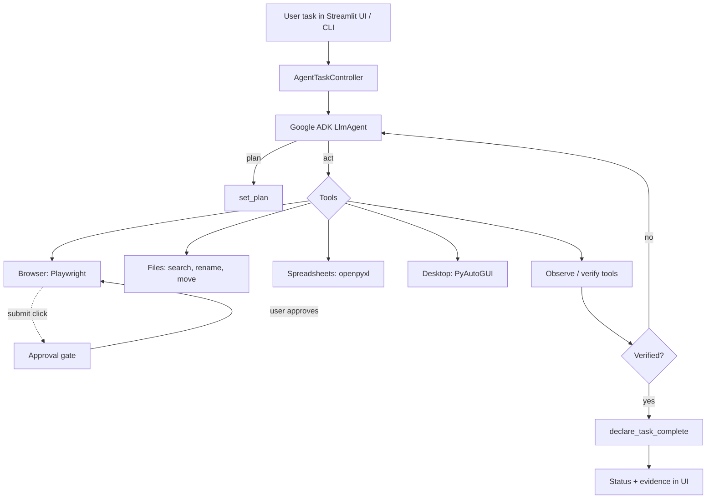

# Exora Desktop Agent

> An autonomous desktop-automation agent built on **Google ADK**. Give it a task in plain English; it plans, operates your browser, files and spreadsheets, recovers from errors, and **verifies the result before claiming success**.

[](https://github.com/<your-username>/exora-desktop-agent/actions)
[](LICENSE)


## Table of contents
- [Overview](#overview)
- [Features](#features)
- [Architecture and flow](#architecture-and-flow)
- [Project structure](#project-structure)
- [Prerequisites](#prerequisites)
- [Installation](#installation)
- [Configuration](#configuration)
- [Quick start](#quick-start)
- [Run with Docker](#run-with-docker)
- [Safety model](#safety-model)
- [Testing](#testing)
- [Limitations](#limitations)
- [Contributing](#contributing)
- [License](#license)

## Overview
Exora takes instructions such as *"Find report_draft.txt in Downloads, rename it and move it to Documents/Archive"* and completes them autonomously using tools for the browser (Playwright), file system, `.xlsx` spreadsheets and, optionally, mouse/keyboard control (PyAutoGUI). It works with any LLM supported by [LiteLLM](https://docs.litellm.ai/) (Groq, OpenAI, Anthropic, Ollama, ...) or Gemini natively.

## Features
- **Plan -> act -> observe -> verify -> decide** loop with a visible plan.
- **Strict verification:** the agent cannot finish with `success=true` unless a verification step ran after its last action. This is enforced in code.
- **Human approval gate:** form submissions are blocked until you approve them in the UI. Also enforced in code.
- **Error recovery:** retries, click fallbacks, popup and dialog handling, slow-page tolerance, loop detection, automatic re-planning.
- **Sandboxed file access:** tools only touch folders you allow, and there is no delete tool.
- **Streamlit UI** with Start/Stop, live log, plan, status and counters, plus a CLI.
- **Provider-safe messages:** a sanitizer strips fields such as `reasoning_content` that strict APIs reject.

## Architecture and flow


Key design points:
1. **ADK callbacks** track every tool call, break repeated-call loops, and maintain verification state in the ADK session.
2. **Browser calls run on one dedicated worker thread**, because Playwright's sync API cannot run inside ADK's asyncio loop.
3. **Models that cannot see images** run in text-only mode: DOM-based browser tools, file tools and keyboard control only.

## Project structure
```
exora-desktop-agent/
├── main.py                  # CLI runner
├── ui.py                    # Streamlit UI
├── exora_agent/
│   ├── agent.py             # ADK agent definition
│   ├── prompts.py           # system instruction
│   ├── callbacks.py         # tracking, loop guard, verification state
│   ├── runtime.py           # runner, sessions, start/stop, error recovery
│   ├── llm_sanitizer.py     # strips unsupported message fields
│   ├── preflight.py         # API key / model check
│   ├── tracking.py          # tracker, stop flag, approval gate
│   ├── config.py
│   └── tools/               # browser, files, spreadsheet, computer, control
├── tests/
├── docs/
├── Dockerfile, docker-compose.yml
└── requirements.txt, requirements-dev.txt, .env.example
```

## Prerequisites
- Python 3.10 or newer
- An API key for your LLM provider (default setup uses [Groq](https://console.groq.com/keys))
- For desktop (mouse/keyboard) tools: a desktop session. Not available inside Docker.
- macOS: grant your terminal Accessibility and Screen Recording permission. Linux: an X11 session (Wayland blocks synthetic input).

## Installation
```bash
git clone https://github.com/<your-username>/exora-desktop-agent.git
cd exora-desktop-agent

python -m venv .venv
# Windows:      .venv\Scripts\activate
# macOS/Linux:  source .venv/bin/activate

pip install -r requirements.txt
playwright install chromium
cp .env.example .env      # Windows: copy .env.example .env
```
Then edit `.env` (see [Configuration](#configuration)).

## Configuration
All settings are environment variables, loaded from `.env`. Never commit `.env`.

| Variable | Default | Description |
|---|---|---|
| `GROQ_API_KEY` | - | Key for Groq models (starts with `gsk_`) |
| `EXORA_MODEL` | `groq/llama-3.3-70b-versatile` | LiteLLM model string, e.g. `groq/openai/gpt-oss-120b`; names starting with `gemini` use ADK natively |
| `EXORA_MODEL_VISION` | `false` | Set `true` only for models that accept images |
| `EXORA_ALLOWED_ROOTS` | `~` | Folders the file tools may use (`;` on Windows, `:` elsewhere) |
| `EXORA_DOWNLOAD_DIR` | `~/Downloads` | Default download folder |
| `EXORA_BROWSER_CHANNEL` | empty | `chrome` or `msedge` to use an installed browser |
| `EXORA_BROWSER_HEADLESS` | `false` | Run the browser without a window |
| `EXORA_MAX_LLM_CALLS` | `80` | Hard cap on model calls per task |
| `EXORA_SESSION_DB` | empty | e.g. `sqlite+aiosqlite:///./exora_sessions.db` for persistent sessions |
| `EXORA_PORT` | `8501` | UI port (Docker) |

Check your key and model from the UI sidebar (**Test API key & model**) before running a task.

## Quick start
```bash
streamlit run ui.py                # UI at http://localhost:8501
python main.py "Find report_draft.txt in ~/Downloads, rename it to report_final.txt and move it to ~/Documents/Archive"
```
Example tasks:
- `Open https://the-internet.herokuapp.com/download, download the first .txt file and save it in ~/Documents/AgentTests`
- `Open ~/Documents/AgentTests/contacts.xlsx and add a row: Asha Rao, asha@example.com, Bengaluru`
- `Go to https://www.selenium.dev/selenium/web/web-form.html, fill the text field with "Exora Test" and stop for my approval before submitting`

While a desktop task runs, keep your hands off the mouse and keyboard. Moving the mouse into a screen corner aborts the run.

## Run with Docker
```bash
cp .env.example .env        # add your API key
docker compose up --build
# open http://localhost:8501
```
Files the agent creates appear in `./workspace/` on your machine. **Docker runs headless:** the browser, file and spreadsheet tools work, but the container cannot control your host's mouse, keyboard or screen. Use a local install for desktop tasks.

## Safety model
- File tools are limited to `EXORA_ALLOWED_ROOTS`; files are never overwritten or deleted.
- Submit-like clicks and Enter in form fields are blocked until you approve in the UI.
- Web page content is treated as data, not instructions.
- Typed values (including credentials) appear in the execution log. Use throw-away test accounts.
- Run it on a test machine or VM when trying new tasks.

## Testing
```bash
pip install -r requirements-dev.txt
python -m pytest -q
```
The offline suite needs no API key, display or browser. It covers the file and spreadsheet tools, the verification gate, the approval gate, message sanitizing and an end-to-end ADK run with a scripted model. Real-model runs are documented in `docs/TEST_REPORT.md`.

## Limitations
- Pixel-level clicking needs a vision-capable model and is the least reliable path; DOM-based browser automation is far more reliable.
- One task at a time and one automated browser profile (not logged in to your accounts).
- Free-tier LLM rate limits can slow long tasks; the agent backs off and retries.

## Contributing
Contributions are welcome.
1. Fork the repository and create a branch: `git checkout -b feature/my-change`
2. Install dev dependencies: `pip install -r requirements-dev.txt`
3. Add or update tests for your change and run `python -m pytest -q`
4. Keep new tools safe: return `{"status": ..., "hint": ...}` through the `@safe_tool` decorator, and make mutating tools verify their own result
5. Open a pull request describing what changed and why

Please open an issue first for large changes. Report security problems privately to the maintainer instead of a public issue.

## License
Released under the [MIT License](LICENSE).
